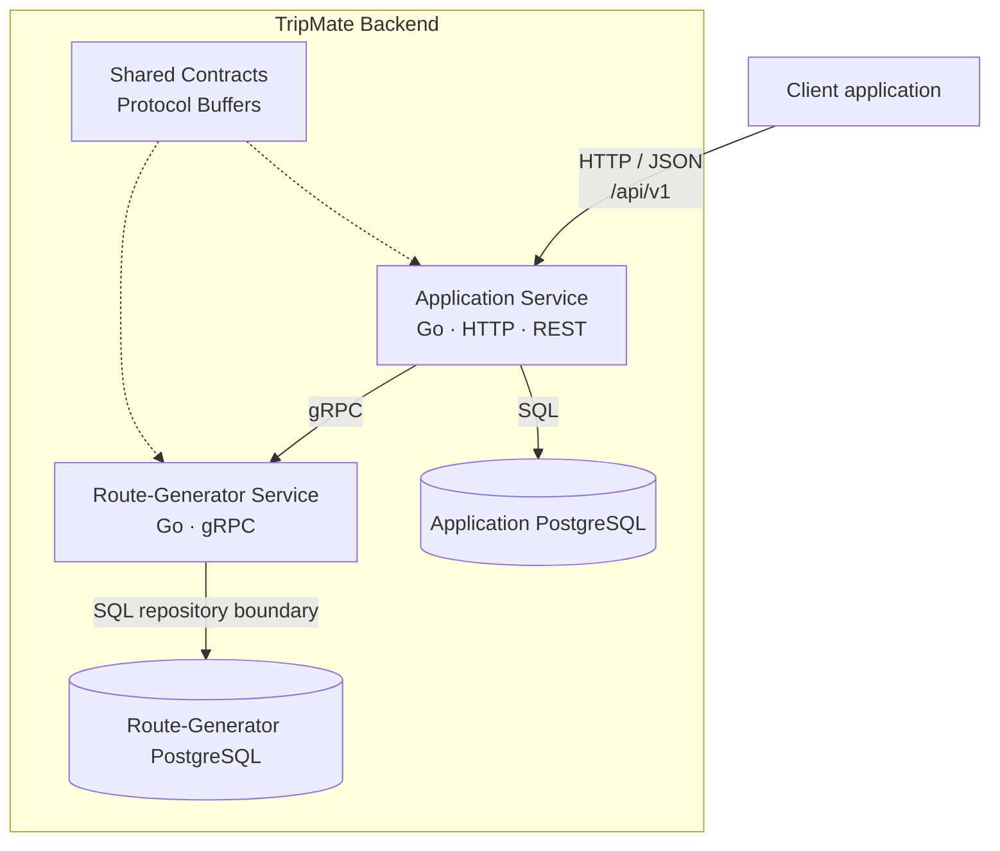
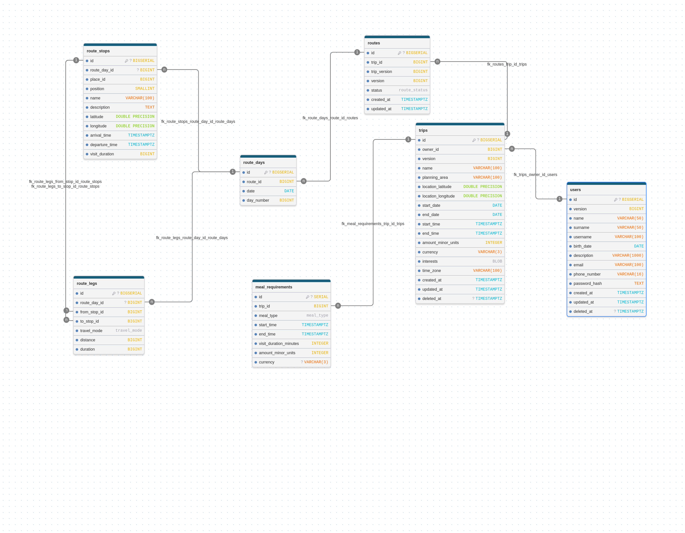
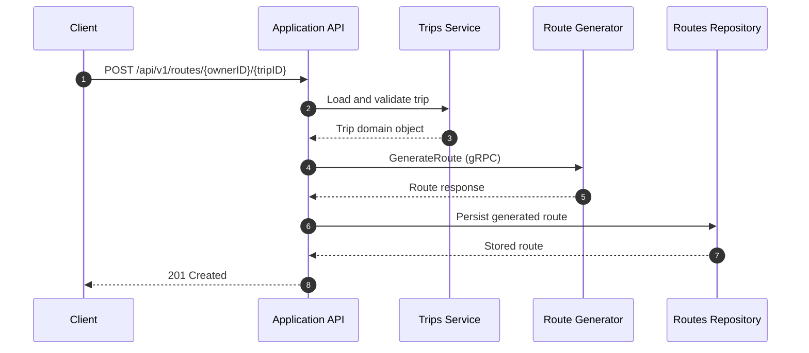

 <!-- Copyright (c) 2026 Alexey Bobkov. All rights reserved. -->

<div align="center">

# TripMate

### Plan less. Explore more.

**Design, optimize, and manage your journeys.**

A travel-planning platform built around structured trip constraints, intelligent itinerary generation, and a service-oriented backend.

<br/>

[](https://github.com/AlexeyBobkovDev/tripmate/actions/workflows/ci.yml)


<br/>

[Overview](#-overview) •
[Architecture](#-architecture) •
[Features](#-features) •
[Technology](#-technology-stack) •
[Getting Started](#-getting-started) •
[API](#-api-reference) •
[Development](#-development) •
[Roadmap](#-roadmap) •
[License](#-license)

</div>

---

> [!IMPORTANT]
> **Project status: Active development**
>
> TripMate is an evolving engineering project, not a finished travel product. Its backend foundation, service communication, persistence layers, and API contracts are under development.
>
> Route generation currently operates as a prototype. It must not be treated as production-ready navigation or route optimization.

## 📖 Overview

TripMate is a travel-planning platform designed to transform personal preferences, geographical information, and practical constraints into structured travel itineraries.

Rather than simply presenting travelers with a collection of attractions, TripMate aims to approach travel planning as an optimization problem.

A trip is represented through explicit planning parameters:

| Dimension | Description |
|---|---|
| 📍 Location | Where the journey takes place and where it starts |
| 📅 Schedule | Travel dates and available time |
| 💰 Budget | Financial constraints and spending preferences |
| ❤️ Interests | What the traveler wants to discover |
| 🍽️ Meals | Meal requirements, time windows, and durations |
| 🚶 Transportation | Travel modes and movement between locations |
| 🗺️ Itinerary | Structured days, stops, and travel legs |

The long-term objective is to allow travelers to describe what matters to them and receive a coherent, manageable itinerary that respects their constraints.

### Initial geographic scope

The initial product scope focuses on **Nizhny Novgorod, Russia**, and its main attractions.

Starting with a single city allows the project to concentrate on the underlying engineering challenges: geographical data, opening hours, scheduling constraints, route optimization, and itinerary generation.

The architecture is intended to support future geographic expansion without coupling the entire application to one location.

### Engineering philosophy

TripMate is developed with an emphasis on software engineering fundamentals:

- **Domain-driven design:** Explicit domain models, business rules, and validation.
- **Separation of concerns:** Independent transport, application, domain, and persistence layers.
- **Service boundaries:** Independently organized services communicating through explicit contracts.
- **Data integrity:** Relational persistence, migrations, and version-aware updates.
- **Maintainability:** Clear package boundaries, automated tests, and consistent conventions.
- **Operational awareness:** Health checks, structured logging, graceful shutdown, and observability foundations.
- **Incremental development:** Distinguishing implemented functionality from prototypes and future capabilities.

---

## ✨ Features

This section describes the current repository rather than presenting planned functionality as already implemented.

### Backend capabilities

The repository currently includes:

- HTTP application service with versioned `/api/v1` endpoints.
- User creation, retrieval, partial updates, and deletion.
- Password hashing using Argon2id.
- Trip creation, retrieval, listing, partial updates, and deletion.
- Trip validation covering dates, coordinates, budgets, interests, and time zones.
- Route creation, retrieval, listing, and deletion.
- Route-generation request and response contracts.
- Protocol Buffer service definitions.
- gRPC communication between the application and route-generator.
- PostgreSQL-backed application repositories.
- Database migrations and schema management.
- Swagger/OpenAPI documentation generation.
- Structured logging and HTTP middleware infrastructure.
- Docker Compose development environment.
- Automated testing, formatting, linting, build checks, and security analysis.

### Route-generation prototype

The route-generator establishes the service boundary for itinerary generation.

However, its current implementation is still a prototype:

- It validates incoming trip data.
- It returns a placeholder route.
- It contains hard-coded sample attraction data and dates.
- It does not yet implement real place discovery.
- It does not perform geographical route optimization.
- It does not check live attraction opening hours.
- It does not calculate real road-network travel routes.

The route-generator PostgreSQL repository method is also currently a stub.

The presence of a functioning gRPC boundary and route-generation endpoint should therefore not be interpreted as a completed optimization engine.

### Planned capabilities

The following capabilities represent future development directions:

- Comprehensive point-of-interest catalog for Nizhny Novgorod.
- Interest-based attraction selection.
- Budget-aware itinerary generation.
- Time-constrained scheduling.
- Road-network-aware distance and duration estimation.
- Opening-hours-aware planning, including multiple daily intervals and exceptions.
- Configurable daily schedules.
- Meal requirements with configurable time windows, durations, and priorities.
- Manual itinerary editing and attraction selection.
- Multi-day trip planning.
- Route regeneration.
- Collaborative trips.
- Weather-aware itinerary adjustments.
- Expense management.
- AI-powered travel assistance.

---

## 🏗️ Architecture

TripMate follows a service-oriented architecture with clearly separated responsibilities.

The application service owns the public HTTP API, user and trip management, and route lifecycle orchestration.

The route-generator service provides the dedicated boundary for itinerary generation.

Communication between these services is implemented through gRPC using shared, versioned Protocol Buffer contracts.

### System context



The diagram illustrates service boundaries and dependencies. It does not imply that every persistence path or route-generation capability is complete.

### Service responsibilities

| Component | Responsibility |
|---|---|
| **Application Service** | Public HTTP API, user and trip use cases, route lifecycle, request validation, and orchestration. |
| **Route-Generator Service** | gRPC endpoint and route-generation domain boundary. |
| **Application PostgreSQL** | Persistent application data, including users, trips, and routes. |
| **Route-Generator PostgreSQL** | Separate database boundary reserved for generator-related data. |
| **Contracts Module** | Versioned Protocol Buffer schemas and generated Go/gRPC code shared between services. |

### Application database schema

The following diagram illustrates the relational database structure of the TripMate application, including its tables, relationships, and data organization.

<div align="center">



<sub>Application PostgreSQL — Entity Relationship Diagram</sub>

</div>

### Route creation flow

The following sequence diagram illustrates the route creation process across the application's service boundaries.



The current generator returns a prototype response rather than an optimized itinerary.

### Repository structure

```text
tripmate/
│
├── contracts/
│   ├── proto/                     # Versioned Protocol Buffer definitions
│   ├── gen/go/                    # Generated Go and gRPC code
│   ├── buf.yaml                   # Buf module configuration
│   ├── buf.gen.yaml               # Code generation configuration
│   └── Makefile
│
├── deploy/
│   └── docker-compose.dev.yml     # Local multi-container environment
│
├── docs/
│   └── diagrams/
│       └── app_database_diagram.png
│
├── services/
│   │
│   ├── app/
│   │   ├── cmd/app/               # Application entry point and Dockerfile
│   │   ├── config/
│   │   ├── docs/                  # Generated Swagger documentation
│   │   ├── migrations/
│   │   └── internal/
│   │       ├── core/              # Domain and shared infrastructure
│   │       └── features/          # Users, trips, routes
│   │
│   └── route_generator/
│       ├── cmd/route_generator/
│       ├── config/
│       ├── migrations/
│       └── internal/
│           ├── core/
│           └── features/
│               └── generate-route/
│
├── .github/
│   └── workflows/                # CI workflows
│
├── .env.example                  # Environment variable template
├── Makefile                      # Root development commands
├── LICENSE                       # Proprietary license
└── README.md
```

The codebase uses feature-oriented packages and separates transport, service, repository, and domain concerns. Exact package boundaries may evolve as the system develops.

---

## 🛠️ Technology Stack

TripMate uses a modern Go-oriented backend stack.

| Area | Technology |
|---|---|
| Primary language | Go 1.27.4 |
| HTTP API | Go `net/http`, JSON |
| Inter-service communication | gRPC |
| API contracts | Protocol Buffers, Buf |
| API documentation | Swaggo, Swagger UI |
| Relational database | PostgreSQL 18.4 |
| PostgreSQL driver | pgx |
| Database migrations | golang-migrate |
| Password hashing | Argon2id |
| Configuration | Environment variables, envconfig, godotenv |
| Logging | Uber Zap |
| Validation | go-playground/validator, domain validation, Protovalidate |
| Testing | Go testing, Testify, GoMock, Testcontainers |
| Containers | Docker, Docker Compose |
| CI/CD | GitHub Actions |
| Static analysis | golangci-lint, go vet |
| Security analysis | CodeQL, govulncheck |

### Technology decisions

**Go**

Provides a statically typed, compiled foundation for network services and concurrent workloads.

**PostgreSQL**

Provides transactional relational persistence for structured trip data and application entities.

**gRPC and Protocol Buffers**

Establish explicit, typed communication contracts between independently developed services.

**Docker Compose**

Provides a reproducible local environment for running the multi-service system and its databases.

**Testcontainers**

Allows integration tests to exercise real dependencies in containers rather than relying exclusively on mocks.

---

## 🚀 Getting Started

These instructions describe the repository's local Docker-based development environment.

### Prerequisites

Make sure the following tools are available:

- Git
- Docker Engine
- Docker Compose plugin
- GNU Make
- A terminal and a code editor

For native Go development, install **Go 1.27.4**.

Buf is required when modifying Protocol Buffer contracts.

### 1. Clone the repository

```bash
git clone https://github.com/AlexeyBobkovDev/tripmate.git

cd tripmate
```

### 2. Configure environment variables

Create a local environment file:

```bash
cp .env.example .env
```

Set your local PostgreSQL credentials:

```dotenv
POSTGRES_USER=tripmate
POSTGRES_PASSWORD=replace-with-a-strong-local-password
POSTGRES_DB=tripmate
```

The example environment file also contains development configuration for:

- Service ports.
- PostgreSQL connections.
- Logging.
- Password hashing.
- Rate limiting.
- CORS.
- gRPC connections.

> [!WARNING]
> Never commit your real `.env` file or production credentials. Keep secrets in your local environment or a dedicated secrets manager.

### 3. Start PostgreSQL databases

TripMate uses separate PostgreSQL containers for the application and route-generator services.

Start both databases:

```bash
make app-postgres-up

make route-generator-postgres-up
```

### 4. Start database port forwarders

The migration targets connect to local database ports through the provided port-forwarder containers.

```bash
make app-postgres-port-forward

make route-generator-postgres-port-forward
```

### 5. Apply database migrations

Application database:

```bash
make -C services/app migrate-up
```

Route-generator database:

```bash
make -C services/route_generator migrate-up
```

### 6. Build and run the services

Start the application and its dependencies:

```bash
make app-run
```

Alternatively, start the complete development stack:

```bash
docker compose \
  --env-file .env \
  -f deploy/docker-compose.dev.yml \
  up --build
```

### 7. Verify the application

Check the application's health endpoint:

```bash
curl -i http://localhost:8080/health
```

Swagger UI:

```text
http://localhost:8080/swagger/index.html
```

API base path:

```text
http://localhost:8080/api/v1
```

Host ports can be configured through `.env`.

### 8. Stop the development environment

```bash
docker compose \
  --env-file .env \
  -f deploy/docker-compose.dev.yml \
  down
```

This removes containers and networks while preserving named database volumes.

> [!CAUTION]
> Database cleanup targets can permanently delete persistent data. Review destructive commands carefully before executing them.

---

## ⚙️ Configuration

TripMate reads its configuration from environment variables.

The `.env.example` file is the canonical starting point for local configuration.

| Variable | Purpose | Example |
|---|---|---|
| `POSTGRES_USER` | PostgreSQL username | `tripmate` |
| `POSTGRES_PASSWORD` | PostgreSQL password | Set locally |
| `POSTGRES_DB` | Database name | `tripmate` |
| `POSTGRES_SSLMODE` | PostgreSQL TLS mode | `disable` (local only) |
| `POSTGRES_OPTIMEOUT` | Database operation timeout | `15s` |
| `APP_POSTGRES_HOST` | Application DB host inside Compose | `app-postgres` |
| `APP_POSTGRES_PORT` | Application DB container port | `5432` |
| `APP_EXTERNAL_POSTGRES_PORT` | Host-side application DB port | `5432` |
| `ROUTE_GENERATOR_POSTGRES_HOST` | Generator DB host inside Compose | `route-generator-postgres` |
| `ROUTE_GENERATOR_POSTGRES_PORT` | Generator DB container port | `5432` |
| `ROUTE_GENERATOR_EXTERNAL_POSTGRES_PORT` | Host-side generator DB port | `5433` |
| `APP_PORT` | HTTP API port | `8080` |
| `ROUTE_GENERATOR_PORT` | gRPC service port | `8081` |
| `APP_SERVER_ADDR` | HTTP listen address | `:8080` |
| `ROUTE_GENERATOR_SERVER_ADDR` | gRPC listen address | `:8081` |
| `ROUTE_GENERATOR_SERVER_TO_CONNECT` | gRPC target | `route-generator:8081` |
| `LOGGER_LEVEL` | Logging verbosity | `DEBUG` |
| `PASSWORDHASHER_ITERATIONS` | Argon2id iteration count | `3` |
| `PASSWORDHASHER_MEMORY` | Argon2id memory in KiB | `65536` |
| `PASSWORDHASHER_PARALLELISM` | Argon2id parallelism | `2` |
| `PASSWORDHASHER_SALT_LENGTH` | Salt length | `16` |
| `PASSWORDHASHER_KEY_LENGTH` | Derived key length | `32` |
| `MAX_REQUESTS_AMOUNT` | Rate-limit request count | `30` |
| `WINDOW_SIZE` | Rate-limit window | `10s` |
| `CORS_ALLOWED_ORIGINS` | Allowed browser origins | `http://localhost:8080` |
| `CORS_ALLOWED_METHODS` | Allowed HTTP methods | `GET,POST,PUT,PATCH,DELETE,OPTIONS` |
| `CORS_ALLOWED_HEADERS` | Allowed request headers | `Content-Type,Authorization` |
| `TIME_ZONE` | Application time zone | `Europe/Moscow` |

**Networking detail:** Docker Compose services communicate using container DNS names and container ports. Host-side database tools use the forwarded host ports.

---

## 🔌 API Reference

The public HTTP API is versioned under:

```text
/api/v1
```

Interactive API documentation is available through Swagger UI:

```text
http://localhost:8080/swagger/index.html
```

### Users

| Method | Endpoint | Description |
|---|---|---|
| `POST` | `/users` | Create a user |
| `GET` | `/users/{userID}` | Retrieve a user |
| `PATCH` | `/users/{userID}` | Partially update a user |
| `DELETE` | `/users/{userID}` | Delete a user |

User creation validates profile fields, email, E.164 phone number, birth date, and password constraints.

Passwords are processed using the Argon2id password-hashing component.

### Trips

| Method | Endpoint | Description |
|---|---|---|
| `POST` | `/trips/{ownerID}` | Create a trip |
| `GET` | `/trips/{ownerID}` | List trips for an owner |
| `GET` | `/trips/{ownerID}/{tripID}` | Retrieve a trip |
| `PATCH` | `/trips/{ownerID}/{tripID}` | Partially update a trip |
| `DELETE` | `/trips/{ownerID}/{tripID}` | Delete a trip |

A trip request currently includes:

| Field | Description |
|---|---|
| `name` | Trip name |
| `planning_area` | Geographic planning area |
| `start_location` | Starting coordinates |
| `start_date` | Trip start date |
| `end_date` | Trip end date |
| `budget` | Monetary budget |
| `interests` | Selected interests |
| `time_zone` | IANA time-zone identifier |

Current interest categories include history, nature, food, and architecture.

#### Example request

The following example illustrates the conceptual request structure:

```json
{
  "name": "Explore Nizhny Novgorod",
  "planning_area": "Nizhny Novgorod",
  "start_location": {
    "latitude": 56.3269,
    "longitude": 44.0059
  },
  "start_date": "2026-12-30",
  "end_date": "2026-12-30",
  "budget": {
    "amount_minor_units": 500000,
    "currency": "RUB"
  },
  "interests": [
    "history",
    "architecture"
  ],
  "time_zone": "Europe/Moscow"
}
```

The exact JSON representation of enum values and nested DTOs is defined by the generated API documentation and transport structures.

### Routes

| Method | Endpoint | Description |
|---|---|---|
| `POST` | `/routes/{ownerID}/{tripID}` | Generate and create a route |
| `GET` | `/routes/{tripID}` | List routes for a trip |
| `GET` | `/routes/{tripID}/{routeID}` | Retrieve a route |
| `DELETE` | `/routes/{tripID}/{routeID}` | Delete a route |

The route domain is structured around four primary concepts:

**Route**

Represents a generated itinerary and its status.

**Route Day**

Represents a dated segment of an itinerary.

**Route Stop**

Represents a place to visit, including its coordinates, order, and scheduled arrival and departure times.

**Route Leg**

Represents travel between two stops, including travel mode, distance, duration, and geometry.

The contracts define walking, cycling, driving, and transit travel modes.

The actual optimization and road-network routing implementation remains under development.

### API security considerations

Current API paths include owner IDs as route parameters. This must not be interpreted as a complete authorization mechanism.

Authentication and authorization must be implemented before exposing the application to untrusted users.

The repository currently contains an unfinished token-to-user identity placeholder in rate-limiter middleware.

---

## 🧪 Testing and Quality Assurance

Testing is organized per Go service and covers multiple testing levels.

| Testing level | Purpose | Command |
|---|---|---|
| Unit tests | Test isolated business logic and components | `make -C services/app test-unit` |
| Integration tests | Exercise components with real dependencies | `make -C services/app test-integration` |
| End-to-end tests | Exercise complete service flows | `make -C services/app test-e2e` |
| Full test suite | Run unit, integration, and E2E-tagged tests | `make -C services/app test` |
| Benchmarks | Measure performance and memory usage | `make -C services/app benchmark` |

Equivalent commands are available for `services/route_generator`.

```bash
make -C services/route_generator test-unit

make -C services/route_generator test-integration

make -C services/route_generator test-e2e

make -C services/route_generator test
```

Integration tests use Testcontainers to run real PostgreSQL dependencies.

The provided Make targets use the Go race detector and disable test-result caching.

### Code quality

The repository workflows include:

- `gofmt`, `goimports`, `gofumpt`, and `gci` formatting checks.
- `golangci-lint`.
- `go vet`.
- Unit, integration, and end-to-end tests.
- CodeQL static analysis.
- `govulncheck` vulnerability checks.
- Swagger documentation regeneration checks.
- Buf formatting and linting.
- Protocol Buffer code generation checks.

### Continuous Integration

GitHub Actions runs the CI workflow for pushes and pull requests targeting `main`.

The pipeline uses reusable jobs for:

- Linting.
- Automated testing.
- Service builds.
- API documentation.
- Protocol Buffer contracts.
- Security analysis.

Docker image publishing is configured for the `main` branch workflow and depends on repository secrets.

---

## 📡 Protocol Buffer Contracts

Shared service contracts are maintained in:

```text
contracts/proto/
```

The contracts module uses Buf v2 configuration and includes:

- Protocol Buffer linting.
- Breaking-change detection.
- Go code generation.
- gRPC Go code generation.
- Protovalidate definitions.

### Working with contracts

Navigate to the contracts directory:

```bash
cd contracts
```

Format definitions:

```bash
buf format -w
```

Lint the module:

```bash
buf lint
```

Generate Go and gRPC code:

```bash
buf generate
```

Build the module:

```bash
buf build
```

Check compatibility against the configured baseline:

```bash
buf breaking --against '../.git#branch=main,subdir=contracts/proto'
```

> [!NOTE]
> Always modify the source `.proto` definitions and regenerate generated code. Do not manually edit generated files.

---

## 👨‍💻 Development

Each service has its own Go module and Makefile.

This keeps service-specific commands and dependencies explicit while allowing both services to share contracts.

### Root-level commands

The root Makefile provides shortcuts for common development operations.

**Application service**

```bash
make app-run

make app-postgres-up
make app-postgres-down

make app-postgres-port-forward
make app-postgres-port-close
```

**Route-generator service**

```bash
make route-generator-run

make route-generator-postgres-up
make route-generator-postgres-down

make route-generator-postgres-port-forward
make route-generator-postgres-port-close
```

### Service-level commands

Each service Makefile provides commands for:

| Category | Commands |
|---|---|
| Database migrations | `migrate-up`, `migrate-down`, `migrate-create` |
| Dependencies | `tidy`, `download`, `update-deps` |
| Formatting | `fmt` |
| Static analysis | `lint` |
| Code generation | `generate` |
| Testing | `test-unit`, `test-integration`, `test-e2e`, `test` |
| Performance | `benchmark` |

Example:

```bash
cd services/app

go test ./...

make lint

make fmt

make migrate-up
```

### Swagger documentation

HTTP endpoint annotations are maintained alongside transport handlers.

Regenerate Swagger documentation using:

```bash
make -C services/app swagger-gen
```

Commit generated documentation changes together with the API changes that produced them.

### Database migrations

Database migrations are maintained separately for each service:

| Service | Migration directory |
|---|---|
| Application | `services/app/migrations` |
| Route-generator | `services/route_generator/migrations` |

Create a migration with a descriptive name:

```bash
make -C services/app migrate-create name=add_trip_preferences
```

Review both the `up` and `down` migrations before applying them.

Never run destructive migration or volume-cleanup commands against data that must be preserved.

---

## 🗺️ Roadmap

TripMate is being developed incrementally, with a focus on establishing a reliable backend foundation before expanding the product experience.

The following roadmap distinguishes completed foundations from future development.

### Platform foundation

- [x] Separate application and route-generator service modules.
- [x] HTTP API and versioned API routing.
- [x] Shared Protocol Buffer contracts.
- [x] gRPC integration boundary.
- [x] PostgreSQL-backed application repositories.
- [x] Docker Compose development environment.
- [x] CI workflows for builds, tests, linting, documentation, contracts, and security checks.
- [ ] Complete authentication and authorization.
- [ ] Finish and verify production health checks and operational configuration.

### Trip planning

- [x] Core trip input model: planning area, start coordinates, dates, budget, interests, and time zone.
- [x] Trip CRUD API.
- [x] Route persistence and retrieval API foundation.
- [ ] Complete route-generation algorithm.
- [ ] Integrate a real place catalog and geographical data.
- [ ] Add road-network-aware distance and duration calculation.
- [ ] Add opening-hours-aware planning.
- [ ] Implement configurable daily schedules.
- [ ] Implement meal requirements and scheduling constraints.
- [ ] Support reliable manual route editing and regeneration.
- [ ] Expand multi-day itinerary generation.

### Product experience

- [ ] Deliver the first Nizhny Novgorod-focused experience.
- [ ] Build the client application and connect it to the backend.
- [ ] Improve itinerary visualization and route editing.
- [ ] Explore group collaboration.
- [ ] Introduce expense management.
- [ ] Explore weather-aware itinerary updates.
- [ ] Develop an AI travel companion.

---

## 🔐 Security

Security is an ongoing engineering requirement, not a completed checklist.

### Existing security-related components

The repository currently includes:

- Argon2id password hashing.
- Request validation.
- Configurable CORS middleware.
- Rate-limiting middleware.
- Request ID middleware.
- Tracing middleware.
- Panic recovery.
- Automated static analysis.
- Vulnerability scanning.

### Before production deployment

The following areas require further implementation and review:

- Complete authentication and authorization.
- Verified identity propagation between application components.
- Authorization checks for every user-owned resource.
- Secure secret management.
- Production PostgreSQL TLS configuration.
- Review of CORS and rate-limit identity extraction.
- Production-grade gRPC transport security and service identity.
- Deployment-specific monitoring and logging.
- Database backups and recovery procedures.

> [!WARNING]
> The current development configuration is not intended for production deployment.

---

## 🚢 Deployment

The repository currently provides a Docker Compose development environment.

It builds the Go services from their respective Dockerfiles and provisions separate PostgreSQL containers.

The CI configuration also includes Docker build-and-push automation for service images.

However, image publishing is not equivalent to a complete production deployment strategy.

A production environment will require explicit decisions regarding:

- Container orchestration.
- Secret management.
- TLS termination.
- Reverse proxy and ingress.
- Database operations.
- Observability.
- Backup and disaster recovery.
- Deployment rollouts.
- Service availability and scaling.

---

## 📜 Contributions and Permissions

TripMate is a proprietary software project.

Public repository visibility is provided for source-code inspection. It does **not** mean that TripMate is open source or that contributions, reuse, deployment, redistribution, or derivative works are automatically permitted.

Please review the [LICENSE](LICENSE) before using or redistributing any project material.

No contribution should be assumed accepted or licensed without explicit written agreement from the copyright holder.

---

## ⚖️ License

**All Rights Reserved.**

Copyright © 2026 Alexey Bobkov. All rights reserved.

TripMate is distributed under a proprietary license.

No general license to use, copy, modify, distribute, deploy, or commercially exploit the original project materials is granted by making this repository publicly visible.

Third-party dependencies and materials remain governed by their respective licenses and terms.

See the full [LICENSE](LICENSE) file for the controlling terms.

---

<div align="center">

<br/>

# TripMate

### Plan less. Explore more.

**Design, optimize, and manage your journeys.**

Built with Go, PostgreSQL, gRPC, and a lot of engineering.

<br/>

[GitHub Repository](https://github.com/AlexeyBobkovDev/tripmate)

<br/>

<sub>Copyright © 2026 Alexey Bobkov. All rights reserved.</sub>

</div>
