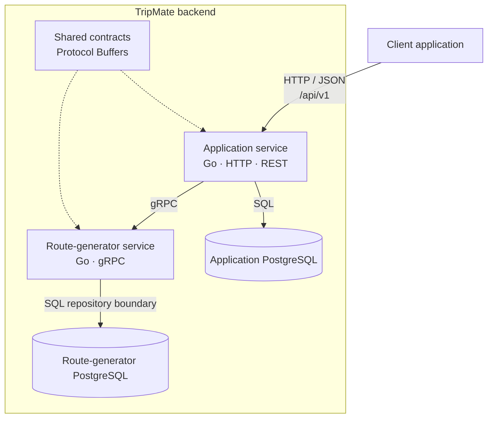

<!-- Copyright (c) 2026 Alexey Bobkov. All rights reserved. -->

<div align="center">

# TripMate

### Plan less. Explore more.

**Design, optimize, and manage your journeys.**

A travel-planning platform built around structured trip constraints, route generation, and a service-oriented backend.

<p>
<a href="https://github.com/AlexeyBobkovDev/tripmate/actions/workflows/ci.yml"></a>


</p>

<p>
<a href="#overview">Overview</a> • <a href="#architecture">Architecture</a> • <a href="#features">Features</a> • <a href="#technology-stack">Stack</a> • <a href="#getting-started">Get started</a> • <a href="#api-reference">API</a> • <a href="#development">Development</a> • <a href="#roadmap">Roadmap</a> • <a href="#license">License</a>
</p>

</div>

---

> [!IMPORTANT]
> **Project status: active development.** TripMate is an evolving project, not a finished travel product. The backend foundation, user/trip management, service communication, persistence layers, and API contracts are under development. Route generation is currently a prototype and must not be treated as production-ready navigation.

## Overview

TripMate is a travel-planning platform intended to turn travel preferences and practical constraints into organized itineraries.

A trip is modeled as structured planning input rather than merely a list of places:

- **Where** the journey takes place and where it starts.
- **When** the traveler is available.
- **How much** they intend to spend.
- **What** they are interested in exploring.
- **How** the itinerary is structured across days, stops, and travel legs.

The long-term goal is to let travelers define what matters to them, receive a structured route, and manage the resulting plan.

### Initial geographic scope

The first product scope is focused on **Nizhny Novgorod, Russia**, and its main attractions. The backend is being structured so that planning logic can evolve without coupling the entire application to one city.

### Engineering principles

| Principle | Application |
| --- | --- |
| **Domain-first design** | Trips, routes, days, stops, and legs are explicit domain concepts with validation rules. |
| **Separation of concerns** | HTTP transport, business logic, persistence, and route generation have distinct boundaries. |
| **Explicit contracts** | Services communicate through versioned Protocol Buffer contracts over gRPC. |
| **Data integrity** | PostgreSQL, migrations, validation, and version-aware trip updates support consistent data handling. |
| **Operational awareness** | Health checks, structured logging, graceful shutdown, request IDs, and CI checks are part of the workflow. |
| **Incremental delivery** | Implemented foundations are distinguished from prototypes and planned capabilities. |

## Features

This section describes the repository as it exists, not an aspirational feature checklist.

### Backend foundations present in the codebase

- HTTP application service with a versioned `/api/v1` route group.
- User creation, retrieval, partial update, and deletion endpoints.
- Password hashing through Argon2id.
- Trip creation, retrieval, listing, partial update, and deletion.
- Trip validation for dates, coordinates, budget, interests, and time zone.
- Route creation, retrieval, listing, and deletion endpoints.
- Route-generation request/response contracts using Protocol Buffers.
- gRPC client/server boundary between the application and route-generator.
- PostgreSQL-backed repository layers and SQL migration workflows.
- Swagger/OpenAPI documentation generation.
- Structured logging and HTTP middleware infrastructure.
- Docker Compose development environment.
- Automated formatting, linting, tests, build checks, contract checks, and security analysis in GitHub Actions.

### Route-generation prototype — important limitation

The route-generator currently validates incoming trip data and returns a **placeholder route**. Its implementation contains hard-coded sample attraction data and dates. It does not yet perform real place discovery, geographic optimization, live opening-hours checks, or road-network routing.

The route-generator PostgreSQL repository method is also currently a stub. The existence of a gRPC contract and route-generation endpoint must not be interpreted as evidence that a complete route-optimization engine is available.

### Planned product capabilities

These are product directions, not claims about functionality already shipped:

- A richer attraction and point-of-interest catalog for Nizhny Novgorod.
- Itinerary generation based on interests, available time, and budget.
- Real travel-time and distance estimation using routing data.
- Opening-hours-aware planning, including multiple daily intervals and exceptions.
- Daily schedules with configurable start and end times.
- Meal planning with configurable meal windows, durations, and priorities.
- Manual itinerary editing and place selection.
- Multi-day journeys and route regeneration.
- Later enhancements such as collaborative trips, weather-aware replanning, expense management, and an AI travel companion.

## Architecture

TripMate is organized as a small service-oriented system. The application service owns the public HTTP API and trip lifecycle; the route-generator service owns the route-generation boundary. They communicate through gRPC and share generated contract code from the `contracts` module.

### System context



The diagram describes service and dependency boundaries. It does not imply that every persistence path or route-generation capability is complete.

### Service responsibilities

| Component | Responsibility |
| --- | --- |
| **Application service** | Public HTTP API, user and trip use cases, route lifecycle, request validation, and orchestration. |
| **Route-generator service** | gRPC endpoint and route-generation domain boundary. The current generator is a placeholder. |
| **Application PostgreSQL** | Persistent application data, including users, trips, and routes. |
| **Route-generator PostgreSQL** | Separate database boundary reserved for generator data. Its current generation repository is not implemented. |
| **Contracts module** | Versioned Protocol Buffer schemas and generated Go/gRPC code shared by both services. |

### Route creation flow


This is the orchestration visible in the code. The generator response is currently a prototype response, not an optimized itinerary.

### Repository layout

```text
tripmate/
├── contracts/
│   ├── proto/                  # Versioned Protocol Buffer definitions
│   ├── gen/go/                 # Generated Go and gRPC code
│   ├── buf.yaml                # Buf module, lint, and breaking rules
│   ├── buf.gen.yaml            # Code generation configuration
│   └── Makefile
├── deploy/
│   └── docker-compose.dev.yml  # Local multi-container environment
├── services/
│   ├── app/
│   │   ├── cmd/app/            # Application entry point and Dockerfile
│   │   ├── config/
│   │   ├── docs/               # Generated Swagger documentation
│   │   ├── migrations/
│   │   └── internal/
│   │       ├── core/           # Domain, logging, repository, HTTP infrastructure
│   │       └── features/       # users, trips, routes
│   └── route_generator/
│       ├── cmd/route_generator/
│       ├── config/
│       ├── migrations/
│       └── internal/
│           ├── core/
│           └── features/generate-route/
├── .github/workflows/         # CI workflows
├── .env.example               # Local environment template
├── Makefile                   # Root development commands
└── LICENSE                    # Proprietary license
```

The codebase uses feature-oriented packages and separates transport, service, repository, and domain concerns. Exact package boundaries may evolve.

## Technology stack

| Area | Technologies |
| --- | --- |
| Primary language | Go 1.27.3 |
| HTTP API | Go `net/http`, JSON |
| Inter-service communication | gRPC |
| API contracts | Protocol Buffers, Buf |
| API documentation | Swaggo / Swagger UI |
| Relational database | PostgreSQL 18.4 |
| PostgreSQL driver | pgx |
| Database migrations | golang-migrate |
| Password hashing | Argon2id |
| Configuration | Environment variables, envconfig, godotenv |
| Logging | Uber Zap |
| Validation | go-playground/validator, domain validation, Protovalidate contracts |
| Testing | Go testing, Testify, GoMock, Testcontainers |
| Containers | Docker, Docker Compose |
| CI and analysis | GitHub Actions, golangci-lint, go vet, CodeQL, govulncheck |

### Technology choices

- **Go** provides a statically typed, compiled foundation for network services and concurrent workloads.
- **PostgreSQL** provides transactional relational persistence for structured trip data.
- **gRPC + Protocol Buffers** provide an explicit, typed contract between independently developed services.
- **Docker Compose** makes the multi-service development environment reproducible.
- **Testcontainers** lets integration tests exercise real dependencies in containers instead of relying exclusively on mocks.

## Getting started

These instructions describe the repository's local Docker-based development setup.

### Prerequisites

- Git
- Docker Engine
- Docker Compose plugin
- GNU Make
- A terminal and an editor

For native Go development, install the version declared by the service modules: **Go 1.27.3**. Buf is required when working with Protocol Buffer contracts.

### 1. Clone the repository

```bash
git clone https://github.com/AlexeyBobkovDev/tripmate.git
cd tripmate
```

### 2. Configure environment variables

```bash
cp .env.example .env
```

Set a local PostgreSQL password in `.env`:

```dotenv
POSTGRES_USER=tripmate
POSTGRES_PASSWORD=replace-with-a-strong-local-password
POSTGRES_DB=tripmate
```

The example file contains development defaults for service ports, database ports, logging, password hashing, rate limiting, CORS, and the gRPC connection.

> [!WARNING]
> Never commit your real `.env` file or production credentials. The repository ignores `.env`; keep secrets in your local environment or a dedicated secrets manager.

### 3. Start the databases

The development Compose file defines separate PostgreSQL containers for the application and route-generator services.

```bash
make app-postgres-up
make route-generator-postgres-up
```

### 4. Start database port forwarders and apply migrations

The migration targets connect to local database ports through the provided port-forwarder containers:

```bash
make app-postgres-port-forward
make route-generator-postgres-port-forward
```

Apply migrations:

```bash
make -C services/app migrate-up
make -C services/route_generator migrate-up
```

Create a migration when changing a schema:

```bash
make -C services/app migrate-create name=add_example_table
# Or:
make -C services/route_generator migrate-create name=add_example_table
```

### 5. Build and run the services

The application service depends on healthy application PostgreSQL and route-generator services. The route-generator service depends on its PostgreSQL container.

Start the application and its dependencies:

```bash
make app-run
```

Alternatively, start the complete development stack:

```bash
docker compose --env-file .env -f deploy/docker-compose.dev.yml up --build
```

Stop the stack:

```bash
docker compose --env-file .env -f deploy/docker-compose.dev.yml down
```

This removes containers and networks but preserves named database volumes. Database cleanup targets can delete persistent data; read their prompts carefully before confirming destructive operations.

### 6. Verify the application

The application registers a basic health endpoint:

```bash
curl -i http://localhost:8080/health
```

Swagger UI:

```text
http://localhost:8080/swagger/index.html
```

API base path:

```text
http://localhost:8080/api/v1
```

Host ports are configurable in `.env`.

## Configuration

TripMate reads configuration from environment variables. The repository's `.env.example` is the canonical starting point.

| Variable | Purpose | Example |
| --- | --- | --- |
| `POSTGRES_USER` | PostgreSQL username | `tripmate` |
| `POSTGRES_PASSWORD` | PostgreSQL password | Set locally |
| `POSTGRES_DB` | Database name | `tripmate` |
| `POSTGRES_SSLMODE` | PostgreSQL TLS mode | `disable` (local only) |
| `POSTGRES_OPTIMEOUT` | Database operation timeout | `15s` |
| `APP_POSTGRES_HOST` | App DB host inside Compose | `app-postgres` |
| `APP_POSTGRES_PORT` | App DB container port | `5432` |
| `APP_EXTERNAL_POSTGRES_PORT` | Host-side app DB port | `5432` |
| `ROUTE_GENERATOR_POSTGRES_HOST` | Generator DB host inside Compose | `route-generator-postgres` |
| `ROUTE_GENERATOR_POSTGRES_PORT` | Generator DB container port | `5432` |
| `ROUTE_GENERATOR_EXTERNAL_POSTGRES_PORT` | Host-side generator DB port | `5433` |
| `APP_PORT` | HTTP API port | `8080` |
| `ROUTE_GENERATOR_PORT` | gRPC service port | `8081` |
| `APP_SERVER_ADDR` | HTTP listen address | `:8080` |
| `ROUTE_GENERATOR_SERVER_ADDR` | gRPC listen address | `:8081` |
| `ROUTE_GENERATOR_SERVER_TO_CONNECT` | gRPC target used by app | `route-generator:8081` |
| `LOGGER_LEVEL` | Logging verbosity | `DEBUG` |
| `PASSWORDHASHER_ITERATIONS` | Argon2id iteration count | `3` |
| `PASSWORDHASHER_MEMORY` | Argon2id memory in KiB | `65536` |
| `PASSWORDHASHER_PARALLELISM` | Argon2id parallelism | `2` |
| `PASSWORDHASHER_SALT_LENGTH` | Salt length | `16` |
| `PASSWORDHASHER_KEY_LENGTH` | Derived key length | `32` |
| `MAX_REQUESTS_AMOUNT` | Rate-limit request count | `30` |
| `WINDOW_SIZE` | Rate-limit window | `10s` |
| `CORS_ALLOWED_ORIGINS` | Allowed browser origins | `http://localhost:8080` |
| `CORS_ALLOWED_METHODS` | Allowed HTTP methods | `GET,POST,PUT,PATCH,DELETE,OPTIONS` |
| `CORS_ALLOWED_HEADERS` | Allowed request headers | `Content-Type,Authorization` |
| `TIME_ZONE` | Application time zone | `Europe/Moscow` |

**Networking detail:** Compose service-to-service connections use container DNS names and container ports. Host-side database tools use the forwarded host ports.

## API reference

The public HTTP API is versioned under `/api/v1`. Swagger UI provides the generated interactive API specification at `/swagger/index.html`.

### Users

| Method | Endpoint | Purpose |
| --- | --- | --- |
| `POST` | `/users` | Create a user |
| `GET` | `/users/{userID}` | Retrieve a user |
| `PATCH` | `/users/{userID}` | Partially update a user |
| `DELETE` | `/users/{userID}` | Delete a user |

User creation validates profile fields, email, E.164 phone number, birth date, and password constraints. Passwords are processed through the Argon2id password-hashing component.

### Trips

| Method | Endpoint | Purpose |
| --- | --- | --- |
| `POST` | `/trips/{ownerID}` | Create a trip |
| `GET` | `/trips/{ownerID}` | List trips for an owner |
| `GET` | `/trips/{ownerID}/{tripID}` | Retrieve a trip |
| `PATCH` | `/trips/{ownerID}/{tripID}` | Partially update a trip |
| `DELETE` | `/trips/{ownerID}/{tripID}` | Delete a trip |

A trip request currently includes:

- `name` — trip name.
- `planning_area` — geographic planning area.
- `start_location` — starting coordinates.
- `start_date` and `end_date` — dates in `YYYY-MM-DD` format.
- `budget` — monetary budget.
- `interests` — selected interests.
- `time_zone` — IANA time-zone identifier.

The current interest domain includes history, nature, food, and architecture.

Example request shape (illustrative values):

```json
{
  "name": "Explore Nizhny Novgorod",
  "planning_area": "Nizhny Novgorod",
  "start_location": {
    "latitude": 56.3269,
    "longitude": 44.0059
  },
  "start_date": "2026-12-30",
  "end_date": "2026-12-30",
  "budget": {
    "amount_minor_units": 500000,
    "currency": "RUB"
  },
  "interests": ["history", "architecture"],
  "time_zone": "Europe/Moscow"
}
```

The exact JSON representation of enum values and nested DTOs is defined by the generated API documentation and transport structs. Treat this as a conceptual request shape, not a replacement for Swagger.

### Routes

| Method | Endpoint | Purpose |
| --- | --- | --- |
| `POST` | `/routes/{ownerID}/{tripID}` | Generate and create a route for a trip |
| `GET` | `/routes/{tripID}` | List routes for a trip |
| `GET` | `/routes/{tripID}/{routeID}` | Retrieve a route |
| `DELETE` | `/routes/{tripID}/{routeID}` | Delete a route |

The route domain is structured around:

- **Route** — a generated itinerary and its status.
- **Route day** — a dated segment of the itinerary.
- **Route stop** — a place to visit, its coordinates, order, and scheduled arrival/departure.
- **Route leg** — travel between two stops, including travel mode, distance, and duration.

The contract defines walking, cycling, driving, and transit travel modes. The route-generator's actual optimization and routing logic remains under development.

### API security note

The current API paths include owner IDs as route parameters. Do not interpret this as a complete authorization model. Authentication and authorization must be completed before exposing the service to untrusted users or deploying it publicly. The repository currently contains an unfinished token-to-user identity placeholder in rate-limiter middleware.

## Testing and quality

Testing is organized per Go service and includes multiple levels.

| Level | Purpose | Command |
| --- | --- | --- |
| Unit tests | Test domain logic and isolated components | `make -C services/app test-unit` |
| Integration tests | Exercise components with real dependencies | `make -C services/app test-integration` |
| End-to-end tests | Exercise complete service flows | `make -C services/app test-e2e` |
| Full test suite | Run unit, integration, and E2E-tagged tests | `make -C services/app test` |
| Benchmarks | Run Go benchmarks with memory statistics | `make -C services/app benchmark` |

The same Make targets are available for `services/route_generator`:

```bash
make -C services/route_generator test-unit
make -C services/route_generator test-integration
make -C services/route_generator test-e2e
make -C services/route_generator test
```

Integration tests use Testcontainers modules for PostgreSQL. The provided Make targets use the race detector and disable test-result caching.

### Code quality checks

The repository workflows include:

- `gofmt`, `goimports`, `gofumpt`, and `gci` formatting checks.
- `golangci-lint`.
- `go vet`.
- Unit, integration, and E2E test execution.
- CodeQL analysis.
- `govulncheck` vulnerability checks.
- Swagger documentation regeneration checks.
- Buf formatting, linting, and code generation checks.

### CI pipeline

GitHub Actions runs the CI workflow for pushes and pull requests targeting `main`. The pipeline uses reusable jobs for linting, tests, builds, API documentation, and Protocol Buffer contracts. Docker image publishing is configured for the `main` branch workflow and depends on repository secrets.

## Protocol Buffer contracts

Shared service contracts live in `contracts/proto`. The module uses Buf v2 configuration with standard lint rules, file-level breaking-change rules, Protocol Buffer Go generation, gRPC Go generation, and Protovalidate definitions.

```bash
cd contracts

# Format definitions
buf format -w

# Lint the module
buf lint

# Generate Go and gRPC code
buf generate

# Build the module
buf build

# Check compatibility against the configured baseline
buf breaking --against '../.git#branch=main,subdir=contracts/proto'
```

Update source `.proto` definitions and regenerate code rather than editing generated output manually.

## Development

Each service has its own Go module and Makefile. This keeps service-specific commands and dependencies explicit while allowing the repository to share contracts.

### Common root commands

```bash
make app-run
make app-postgres-up
make app-postgres-down
make app-postgres-port-forward
make app-postgres-port-close

make route-generator-run
make route-generator-postgres-up
make route-generator-postgres-down
make route-generator-postgres-port-forward
make route-generator-postgres-port-close
```

### Service-level commands

Each service Makefile provides commands for database migrations (`migrate-up`, `migrate-down`, `migrate-create`), Go dependencies (`tidy`, `download`, `update-deps`), formatting (`fmt`), static analysis (`lint`), code generation (`generate`), tests (`test-unit`, `test-integration`, `test-e2e`, `test`), and benchmarks (`benchmark`).

Example:

```bash
cd services/app
go test ./...
make lint
make fmt
make migrate-up
```

### Swagger documentation

HTTP endpoint annotations are maintained alongside transport handlers. Regenerate Swagger documentation from the application module:

```bash
make -C services/app swagger-gen
```

Commit generated documentation changes together with the API changes that produced them.

### Database migrations

Keep schema changes versioned and service-local:

- Application migrations: `services/app/migrations`.
- Route-generator migrations: `services/route_generator/migrations`.

Create a migration with a descriptive name:

```bash
make -C services/app migrate-create name=add_trip_preferences
```

Review both the `up` and `down` migration before applying it. Never run destructive migration or volume-cleanup commands against data you need to preserve.

## Roadmap

The roadmap is directional. Items below should be considered planned work unless the corresponding implementation is present in the repository.

### Platform foundation

- [x] Separate application and route-generator service modules.
- [x] HTTP API and versioned API routing.
- [x] Shared Protocol Buffer contracts and gRPC integration boundary.
- [x] PostgreSQL-backed application repositories.
- [x] Docker Compose development environment.
- [x] CI workflows for build, tests, lint, docs, contracts, and security checks.
- [ ] Complete authentication and authorization.
- [ ] Finish and verify production health checks and operational configuration.

### Trip planning

- [x] Core trip input model: planning area, start coordinates, dates, budget, interests, and time zone.
- [x] Trip CRUD API.
- [x] Route persistence and retrieval API foundation.
- [ ] Complete route-generation algorithm.
- [ ] Integrate a real place catalog and geographic data.
- [ ] Add road-network-aware distance and duration calculation.
- [ ] Add opening-hours and schedule constraints.
- [ ] Add configurable daily schedules and meal requirements.
- [ ] Support reliable manual route editing and regeneration.

### Product experience

- [ ] Deliver the first Nizhny Novgorod-focused experience.
- [ ] Build the client application and connect it to the backend.
- [ ] Improve itinerary visualization and route editing.
- [ ] Explore group collaboration, expenses, weather-aware updates, and an AI travel companion.

## Security

Security is an ongoing engineering requirement, not a completed checklist.

Current repository elements include Argon2id password hashing, request validation, configurable CORS and rate-limiting middleware, request IDs, tracing middleware, panic recovery, and automated static/vulnerability analysis.

Before production deployment, the project still needs a complete security review, including:

- A real authentication flow and verified identity propagation.
- Authorization checks for every user-owned resource.
- Secure secret management and production database TLS configuration.
- Review of CORS, rate-limit identity extraction, and abuse controls.
- Production-grade gRPC transport security and service identity.
- Deployment-specific logging, monitoring, backups, and recovery procedures.

Do not deploy the current development configuration as-is for real users.

## Deployment

The repository currently provides a Docker Compose development environment. It builds the Go services from their Dockerfiles and provisions separate PostgreSQL containers.

The CI configuration also includes a Docker build-and-push workflow for service images. This is build/publishing automation; it is not, by itself, a complete production deployment solution.

A production environment will require explicit decisions about orchestration, secrets, TLS, ingress/reverse proxy, database operations, observability, backups, and rollout strategy.

## Contributions and permissions

TripMate is currently a proprietary project. Public repository visibility is provided for source-code inspection; it does **not** mean that the project is open source or that contributions, reuse, deployment, redistribution, or derivative works are automatically permitted.

Please read the [LICENSE](LICENSE) before using or redistributing any project material. No contribution should be assumed accepted or licensed without explicit written agreement from the copyright holder.

## License

**All Rights Reserved.**

Copyright © 2026 Alexey Bobkov. All rights reserved.

TripMate is distributed under a proprietary license. No general license to use, copy, modify, distribute, deploy, or commercially exploit the original project materials is granted by making this repository publicly visible.

Third-party dependencies and materials remain governed by their own licenses and terms. See the full [LICENSE](LICENSE) for the controlling terms.

---

<div align="center">

**TripMate** · Design, optimize, and manage your journeys.

Built with Go, PostgreSQL, gRPC, and a lot of engineering.

<sub>Copyright © 2026 Alexey Bobkov. All rights reserved.</sub>

</div>
